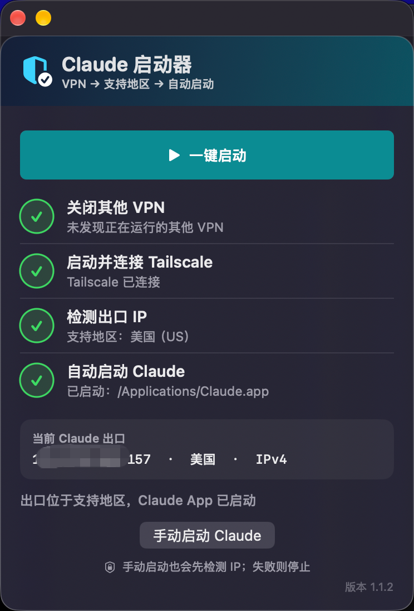

# Claude 启动器 for macOS

一个使用 Swift、SwiftUI 和 AppKit 编写的轻量 macOS 启动器。它可以按顺序关闭其他 VPN、连接 Tailscale、检测访问 Claude 时的出口地区，并在地区通过后打开 Claude Desktop。

> A small native macOS launcher that prepares the local VPN state, checks the
> Claude network egress region, and opens Claude Desktop when the check passes.




## 功能

- 一键执行流程：关闭其他 VPN → 确认 Tailscale 后端和出口节点 → 检测出口 IP → 启动 Claude。
- 用 `tailscale status --json` 判断是否已连上，不看系统 VPN 开关。系统里的 Tailscale 配置开着“按需连接”时，菜单栏 App 没开、后端仍是 Stopped，开关也会显示已连接。
- 提供“手动启动 Claude”，跳过 VPN 操作，但启动前仍重新检测出口地区。
- 直接请求 `https://claude.ai/cdn-cgi/trace`，不打开第三方 IP 检测网页。
- 地区通过后顺带检查时区、系统 DNS 和 IPv6。只有地区不通过会阻止启动，其余只提示。
- 把每一步的结果写到 `~/Library/Logs/ClaudeLauncher/launcher.log`，不记录密钥。
- 使用 macOS 原生窗口、Dock 最小化和可拖动标题栏。
- 在窗口与标准“关于”面板中显示版本、版权和联系信息。
- 提供命令行自检和只读出口检查模式。

## 运行要求

- macOS 13 或更高版本。
- 已安装 `/Applications/Tailscale.app` 和 `/Applications/Claude.app`。
- Tailscale 已登录，并已配置合适的出口节点。
- 从源码构建需要 Xcode Command Line Tools。

## 构建

```zsh
chmod +x build.sh
./build.sh
```

产物位于：

```text
build/Claude 启动器.app
```

构建脚本使用 ad hoc 签名，未进行 Apple Developer ID 签名或公证。首次运行下载的构建产物时，macOS 可能显示安全提示。

在自己的 Mac 上安装这次构建：

```zsh
# 先退出正在运行的启动器
osascript -e 'quit app "Claude 启动器"' || true
rm -rf "/Applications/Claude 启动器.app"
cp -R "build/Claude 启动器.app" /Applications/
open -a "Claude 启动器"
```

仓库的 GitHub Actions 会在 pull request 和合并到 `main` 时执行 `./build.sh` 与自检。它不会另外发布 GitHub Release。本地以 `./build.sh` 的产物为准。

## 验证

```zsh
./build/Claude\ 启动器.app/Contents/MacOS/ClaudeLauncher --self-test
./build/Claude\ 启动器.app/Contents/MacOS/ClaudeLauncher --check-current-ip
codesign --verify --deep --strict --verbose=2 ./build/Claude\ 启动器.app
```

`--check-current-ip` 只输出检测结果，不关闭 VPN，也不启动 Claude。

## 工作原理

1. 根据明确的 Bundle ID 和名称关键词识别其他 VPN 应用，先请求正常退出，必要时强制退出。再用 `scutil --nc` 停掉除 Tailscale 以外、已经连接的系统 VPN 服务。
2. Clash Verge Rev 开了服务模式时，关掉窗口不会停掉 root 下的 `verge-mihomo`。启动器会找本机控制套接字（包括 `/var/run/clash-verge-service/users/<uid>/verge-mihomo.sock`），请求关闭 TUN，并在继续之前确认没有残留的 `198.18.x` 网卡或默认路由。没有装这项服务的 Mac 会跳过这一步。
3. 若 Tailscale App 没在运行就打开它。随后只看 `tailscale status --json`：后端是 Running、本机在线，且当前出口节点在线。后端停着时执行不带参数的 `tailscale up`，沿用已经保存的出口节点；如果旧版命令要求带上全部非默认参数，就按它打印出的那条命令原样再执行一次，不使用 `--reset`。不会写死出口节点的名字。
4. 请求 Claude 的 Cloudflare trace 端点，读取这次请求的出口 IP 和两位地区代码，对照内置的支持地区快照。通过才打开 `/Applications/Claude.app`。
5. 地区通过之后检查三项环境差异，只提示、不拦截：系统时区是否落在出口地区的常见时区里，系统 DNS 是否仍指向中国大陆或局域网解析器，以及 IPv6 出口地区是否和主出口不一致。桌面端没有浏览器 WebRTC，不做这项检查。

支持地区快照于 2026-11-11 根据 [Claude Help Center](https://support.claude.com/en/articles/8461763-where-can-i-access-claude) 核对。官方名单可能变化，更新时需要同步修改 `SupportedRegions.codes`。

## 使用前须知

- “一键启动”会退出匹配到的 VPN 应用，并可能关掉 Clash 的 TUN 和指向本机 Clash 端口的系统代理。请先保存相关应用中的未完成操作。
- 地区检测只能证明这一次 HTTPS 请求看到的出口地区，不能判断 Claude 账号状态，也不能保证桌面端的所有连接走同一路由。
- 时区、DNS 和 IPv6 提示同样只描述这一次看到的环境，不会因为提示而取消启动。
- 日志在 `~/Library/Logs/ClaudeLauncher/launcher.log`。里面有每一步的结果，没有 Tailscale 私钥或 Clash 密钥。
- 本项目不提供代理、出口节点或 Claude 账号，也不用于绕过服务条款或地区规定。使用者应遵守所在地法律及相关服务条款。
- VPN 应用名称和 macOS 网络服务配置因设备而异；在其他电脑上使用前，请审阅 `closeOtherVPNs()` 与 `connectTailscale()`。

## 项目结构

```text
.
├── Sources/ClaudeLauncher/Logic.swift
├── Sources/ClaudeLauncher/main.swift
├── Resources/AppIcon-master.png
├── Tools/make_icns.swift
├── Info.plist
├── build.sh
├── CHANGELOG.md
├── CONTRIBUTING.md
├── SECURITY.md
└── LICENSE
```

## License

代码和项目原创资源采用 [MIT License](LICENSE)。`Claude`、`Anthropic`、`Tailscale` 及相关名称和商标归各自权利人所有。本项目为独立社区项目，与 Anthropic 或 Tailscale 无隶属或认可关系。

© 2026 roylau · [roylau3366@gmail.com](mailto:roylau3366@gmail.com)
