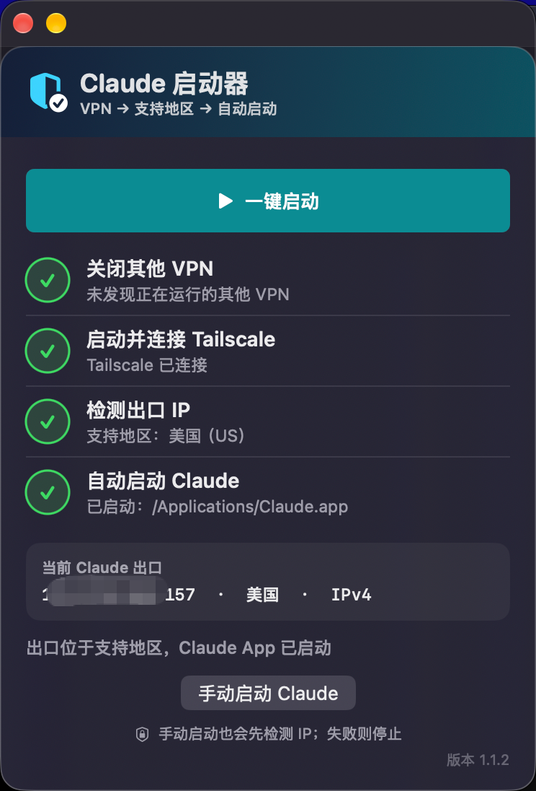

# Claude 启动器 for macOS

一个使用 Swift、SwiftUI 和 AppKit 编写的轻量 macOS 启动器。它可以按顺序关闭其他 VPN、连接 Tailscale、检测访问 Claude 时的出口地区，并在地区通过后打开 Claude Desktop。

> A small native macOS launcher that prepares the local VPN state, checks the
> Claude network egress region, and opens Claude Desktop when the check passes.




## 功能

- 一键执行四步流程：关闭其他 VPN → 连接 Tailscale → 检测出口 IP → 启动 Claude。
- 提供“手动启动 Claude”，跳过 VPN 操作，但启动前仍重新检测出口地区。
- 直接请求 `https://claude.ai/cdn-cgi/trace`，不打开第三方 IP 检测网页。
- 使用 macOS 原生窗口、Dock 最小化和可拖动标题栏。
- 在窗口与标准“关于”面板中显示版本、版权和联系信息。
- 提供命令行自检和只读出口检查模式。

## 运行要求

- macOS 13 或更高版本。
- 已安装 `/Applications/Tailscale.app` 和 `/Applications/Claude.app`。
- Tailscale 已登录，并已配置合适的出口节点。
- 从源码构建需要 Xcode Command Line Tools。

## 构建

```zsh
chmod +x build.sh
./build.sh
```

产物位于：

```text
build/Claude 启动器.app
```

构建脚本使用 ad hoc 签名，未进行 Apple Developer ID 签名或公证。首次运行下载的构建产物时，macOS 可能显示安全提示。

## 验证

```zsh
./build/Claude\ 启动器.app/Contents/MacOS/ClaudeLauncher --self-test
./build/Claude\ 启动器.app/Contents/MacOS/ClaudeLauncher --check-current-ip
codesign --verify --deep --strict --verbose=2 ./build/Claude\ 启动器.app
```

`--check-current-ip` 只输出检测结果，不关闭 VPN，也不启动 Claude。

## 工作原理

1. 根据明确的 Bundle ID 和名称关键词识别其他 VPN 应用，先请求正常退出，必要时强制退出。
2. 使用 macOS `scutil --nc` 停止已连接的其他 VPN 服务，并启动、等待 Tailscale 连接。
3. 请求 Claude 的 Cloudflare trace 端点，读取本次请求对应的出口 IP 与两位地区代码。
4. 将地区代码与代码内保存的 Claude 官方支持地区快照比较；通过才打开 `/Applications/Claude.app`。

支持地区快照于 2026-11-11 根据 [Claude Help Center](https://support.claude.com/en/articles/8461763-where-can-i-access-claude) 核对。官方名单可能变化，更新时需要同步修改 `SupportedRegions.codes`。

## 使用前须知

- “一键启动”会退出匹配到的 VPN 应用并改变本机 VPN 状态。请先保存相关应用中的未完成操作。
- 地区检测只能证明这一次 HTTPS 请求看到的出口地区，不能判断 Claude 账号状态，也不能保证桌面端的所有连接走同一路由。
- 本项目不提供代理、出口节点或 Claude 账号，也不用于绕过服务条款或地区规定。使用者应遵守所在地法律及相关服务条款。
- VPN 应用名称和 macOS 网络服务配置因设备而异；在其他电脑上使用前，请审阅 `closeOtherVPNs()` 与 `connectTailscale()`。

## 项目结构

```text
.
├── Sources/ClaudeLauncher/main.swift
├── Resources/AppIcon-master.png
├── Tools/make_icns.swift
├── Info.plist
├── build.sh
├── CHANGELOG.md
├── CONTRIBUTING.md
├── SECURITY.md
└── LICENSE
```

## License

代码和项目原创资源采用 [MIT License](LICENSE)。`Claude`、`Anthropic`、`Tailscale` 及相关名称和商标归各自权利人所有。本项目为独立社区项目，与 Anthropic 或 Tailscale 无隶属或认可关系。

© 2026 roylau · [roylau3366@gmail.com](mailto:roylau3366@gmail.com)
